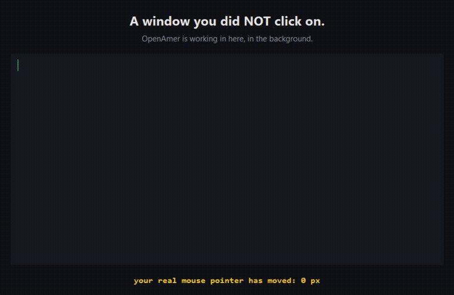

<p align="center">
  
</p>

# OpenAmer Agent

**A self-hosted AI agent with persistent memory, extensible tools, and background desktop control.**

OpenAmer runs through a terminal, a desktop app, a web interface, or a messaging
gateway. Choose your model provider, connect the tools you need, and keep your
own sessions and procedural knowledge in a local profile.

OpenAmer is an independently developed fork of the
[Hermes Agent architecture](https://github.com/NousResearch/hermes-agent) by
Nous Research. Upstream attribution and license notices are preserved in
[NOTICE](NOTICE). OpenAmer's additions include Windows-native integration,
background computer use, learning infrastructure, and verification tooling.

[Documentation](website/docs/) · [Releases](https://github.com/openamer/openamer/releases)
· [Report a bug](https://github.com/openamer/openamer/issues)
· [Contributing](CONTRIBUTING.md) · [Vision](VISION.md)

## Install and start

Review installer scripts before running them. They download software and install
dependencies on your machine.

**Windows — PowerShell:**

```powershell
iex (irm https://raw.githubusercontent.com/openamer/openamer/main/scripts/install.ps1)
```

**Linux / macOS / Termux — shell:**

```bash
curl -fsSL https://raw.githubusercontent.com/openamer/openamer/main/scripts/install.sh | bash
```

For platform-specific requirements, see the
[getting-started documentation](website/docs/getting-started/).
Windows installers are also available from
[GitHub Releases](https://github.com/openamer/openamer/releases).

Then configure a provider and start chatting:

```bash
openamer setup
openamer
```

A model endpoint is required. You can use a supported hosted provider or a
compatible local server. Hosted providers may charge for usage; local inference
requires suitable hardware and downloaded model files. An account, quota,
subscription, or API key may be required depending on your provider. The project
does not guarantee zero operating cost or a particular energy budget.

```bash
openamer model       # choose provider/model
openamer tools       # configure tool backends
openamer doctor      # diagnose your installation
openamer --help      # commands supported by this checkout
```

## What is in the public product?

These are implementation surfaces in this repository, not a claim that every
integration has been tested on every device or that every feature is enabled by
default.

| Area | Included implementation | What you configure or provide |
| --- | --- | --- |
| Agent and interfaces | CLI, TUI, desktop and web interfaces | Model provider; interface-specific dependencies |
| Messaging | Gateway and platform adapters | Your channel credentials and permissions |
| Coding and research | Terminal, files, Python execution, web and vision tools | Tool backends and any external service credentials |
| Browser automation | Browser tools, CDP and browser session support | Browser/backend installation and an authorized session |
| Desktop automation | Background computer-use integration, recording and replay | Supported OS, driver, permissions, and an accessible desktop session |
| Memory and skills | Persistent memory, session search, bundled skills and Skills Hub | Local knowledge accumulated through use; optional skills |
| Multi-agent work | Delegation, crews, swarm, and Kanban coordination | Models, profiles and workers appropriate to the task |
| Extensibility | Plugins, MCP, hooks and toolsets | Explicitly chosen plugins, servers and credentials |
| Learning | Data collection, training/reasoning scripts, ASI wrappers and Darwin engine | Dependencies, runtime configuration, model files and deliberate execution |
| Networking | A2A messaging, mesh-learning code and a Go mesh daemon | Reachable, configured peers and trust relationships |
| Smart home | Philips JointSpace/DLNA TV control and Home Assistant integration | Compatible devices on your network and required authorization |
| Genesis research | Directive probes, replication, tokenomics and contract source | See each probe's gates; source is not evidence of a deployed network |

Explore the implementation in [tools](tools/), [agent](agent/),
[CLI commands](openamer_cli/subcommands/), [gateway](gateway/),
[plugins](plugins/) and [applications](apps/).

### Background desktop control

<p align="center">
  
</p>

[Recording method and limits](docs/demo/README.md).
Background delivery depends on the application and OS. Some applications require
foreground fallback or additional permissions; a successful input delivery is
not, by itself, proof that the intended action occurred.

```bash
openamer computer-use doctor
openamer computer-use record my-task
openamer computer-use play my-task
```

### Learning, Mini-OpenAmer and the ASI modules

The names *brain* and *ASI* identify project components. They are not a benchmark
result or proof of general intelligence, superiority, consciousness, or universal
autonomous capability.

Public source includes [training and reasoning scripts](scripts/training/),
[ASI integration](tools/asi/), [ASI Core](tools/asi_core.py),
[Darwin](scripts/darwin_engine.py), and the
[OpenAmer brain experiments](openamer_brain/README.md).

```bash
openamer brain stats
openamer brain status
openamer asi status
openamer asi --help
openamer a2a --help
```

Collecting examples, retrieving memories, or evolving a skill is not the same
thing as updating model weights. Training and local model serving require their
own dependencies and model artifacts. A repository checkout does not include a
maintainer's tuned model, private learning buffer, local daemon configuration,
memories, credentials, or hardware. Consult [ASI documentation](docs/asi-core.md)
and the script's own prerequisites before running a learning cycle.

### Skills and customization

[Bundled skills](skills/) and [optional skills](optional-skills/) are public.
They are distinct from skills an individual installation creates or imports.
Normal installation synchronizes bundled skills; the Windows installer also
supports `-AllSkills` for the optional collection. Installing more skills does
not guarantee their external dependencies are available.

```bash
openamer skills --help
openamer plugins --help
openamer mcp --help
```

## Public code, local state and releases are different

An update gives you the code published for the version you install. It does not
copy another user's memories, models, accounts, devices or background services.

- **In main:** source available from the repository's main branch.
- **In a pull request:** proposed work, not yet included in main.
- **In a release:** a versioned artifact that may predate newer main commits.
- **Configured locally:** installed code plus your own models, services, data
  and permissions. This is not automatically reproduced elsewhere.

A capability should be described as operational only after its real execution
path has been verified. Missing models, services, permissions or hardware should
be reported as prerequisites, not silently counted as success. There is no
single permanent tool count, skill count or capability score for all profiles.

## Updating

```bash
openamer update --check
openamer update
```

The update workflow includes backup and dependency/install handling. On Windows,
active processes can hold files open. Follow the updater's diagnostics rather
than killing arbitrary processes or deleting the installation. Local commits
and uncommitted work need preservation before changing branches or resetting a
checkout.

Check your actual version and installation path with:

```bash
openamer --version
```

## Safety and privacy

OpenAmer can execute commands, use logged-in browser sessions, and operate your
desktop. Review permissions and approve sensitive actions. Use isolated
execution where appropriate. A sandbox, redactor or approval prompt is a defense,
not an absolute guarantee.

- Keep credentials in the profile's secret store or `.env`, not in code or
  published skills. Non-secret settings belong in `config.yaml`.
- Memory and sessions belong to the local profile. Sharing, exports, plugins,
  cloud inference and configured gateways can send data outside your machine;
  review the selected backend and sharing settings.
- Do not publish your profile directory, private learning data, device registry,
  browser state or model artifacts without reviewing their contents and licenses.
- See [SECURITY.md](SECURITY.md) for reporting vulnerabilities.

## Development and verification

Use the [contributor guide](CONTRIBUTING.md) and the canonical per-file test
runner, which isolates test files in separate subprocesses:

```bash
bash scripts/run_tests.sh tests/agent/
```

Passing tests are evidence for the tested revision and scope, not a promise that
every integration, provider, account or platform will always work. Include actual
test output and state prerequisites when reporting a feature.

Translated introductions: [Deutsch](README.de.md), [Español](README.es.md),
[Français](README.fr.md), [日本語](README.ja.md), [Português](README.pt.md),
[Русский](README.ru.md), [中文](README.zh.md). Translations can lag the current
English documentation.

## Support and license

[Products](PRODUCTS.md) · [Sponsorship](SPONSORS.md)
· [GitHub](https://github.com/openamer/openamer)

OpenAmer is licensed under [Apache-2.0](LICENSE). Inherited and third-party
components retain their applicable licenses and attribution; see [NOTICE](NOTICE).
