# Darwin Engine Report
_2026-11-08T08:40:28.761811+00:00 — evolutionary skill ecosystem_

**Population:** 1274 Skills | **Offspring:** 5 | **Competitions:** 33

## Top 10 (fittest skills)

| Skill | Fitness | Usage | Age (days) | Mutationen W/L |
|---|---|---|---|---|
| darwin-cron-guard | 3299.0 | 279 | 0 | 1525/44 |
| autonomous-learning-architecture | 3294.0 | 606 | 0 | 1489/306 |
| darwin-harvested-training-internet-learn-log-jsonl | 3280.0 | 273 | 0 | 1507/21 |
| asi-capability-summary | 855.53 | 844 | 44 | 0/0 |
| a2a-brain-meshlearn-verify | 852.1 | 840 | 27 | 0/0 |
| auto-env-checker | 465.53 | 512 | 44 | 15/88 |
| learning-loop | 442.4 | 432 | 78 | 0/0 |
| cdp-social-posting | 347.17 | 332 | 25 | 0/0 |
| mini-openamer | 200.2 | 188 | 24 | 0/0 |
| train-from-usage | 112.4 | 104 | 48 | 0/4 |

## Bottom 5 (selection candidates)

- **tao-setup-nvidia-gpu-host** (Fitness 7.07, 28 days old)
- **tao-train-optical-inspection** (Fitness 7.07, 28 days old)
- **web-artifacts-builder** (Fitness 7.07, 28 days old)
- **xlsx** (Fitness 7.07, 28 days old)
- **cron-autotest-run-cron-entry** (Fitness 6.4, 48 days old)

## New mutations

- darwin-cron-guard → `darwin-cron-guard__mutbroaden_trigger` (op=broaden_trigger, applied=True)
- autonomous-learning-architecture → `autonomous-learning-architecture__mutbroaden_trigger` (op=broaden_trigger, applied=True)
- darwin-harvested-training-internet-learn-log-jsonl → `darwin-harvested-training-internet-learn-log-jsonl__muttighten_trigger` (op=tighten_trigger, applied=True)
- asi-capability-summary → `asi-capability-summary__mutbroaden_trigger` (op=broaden_trigger, applied=True)
- a2a-brain-meshlearn-verify → `a2a-brain-meshlearn-verify__muttighten_trigger` (op=tighten_trigger, applied=True)

## Competitions

- ⏳ `a2a-brain-meshlearn-verify+asi-capability-summary` (0) vs `None` (0)
- ⏳ `a2a-brain-meshlearn-verify__mutbroaden_trigger` (852.1) vs `a2a-brain-meshlearn-verify` (852.1)
- ⏳ `a2a-brain-meshlearn-verify__muttighten_trigger` (852.1) vs `a2a-brain-meshlearn-verify` (852.1)
- ⏳ `asi-capability-summary+asi-identity` (0) vs `None` (0)
- ⏳ `asi-capability-summary__mutbroaden_trigger` (855.53) vs `asi-capability-summary` (855.53)
- ⏳ `asi-capability-summary__muttighten_trigger` (855.53) vs `asi-capability-summary` (855.53)
- ⏳ `asi-identity+auto-env-checker` (0) vs `None` (0)
- ⏳ `auto-env-checker+autonomous-learning-architecture` (0) vs `None` (0)
- ⏳ `auto-env-checker+cdp-social-posting` (0) vs `None` (0)
- ⏳ `auto-env-checker__mutbroaden_trigger` (465.53) vs `auto-env-checker` (465.53)
- ⏳ `auto-env-checker__muttighten_trigger` (465.53) vs `auto-env-checker` (465.53)
- ⏳ `autonomous-learning-architecture__mutbroaden_trigger` (3294.0) vs `autonomous-learning-architecture` (3294.0)
- ⏳ `autonomous-learning-architecture__muttighten_trigger` (3294.0) vs `autonomous-learning-architecture` (3294.0)
- ⏳ `cdp-social-posting__mutbroaden_trigger` (347.17) vs `cdp-social-posting` (347.17)
- ⏳ `cdp-social-posting__muttighten_trigger` (347.17) vs `cdp-social-posting` (347.17)
- ⏳ `darwin-cron-guard__mutbroaden_trigger` (3299.0) vs `darwin-cron-guard` (3299.0)
- ⏳ `darwin-cron-guard__muttighten_trigger` (3299.0) vs `darwin-cron-guard` (3299.0)
- ⏳ `darwin-harvested-training-internet-learn-log-jsonl__mutbroaden_trigger` (3280.0) vs `darwin-harvested-training-internet-learn-log-jsonl` (3280.0)
- ⏳ `darwin-harvested-training-internet-learn-log-jsonl__muttighten_trigger` (3280.0) vs `darwin-harvested-training-internet-learn-log-jsonl` (3280.0)
- ⏳ `discord-server-management__mutadd_verification_step` (25.27) vs `discord-server-management` (25.27)
- ⏳ `discord-server-management__mutbroaden_trigger` (25.27) vs `discord-server-management` (25.27)
- ⏳ `discord-server-management__muttighten_trigger` (25.27) vs `discord-server-management` (25.27)
- ⏳ `github-readme-summary__mutbroaden_trigger` (21.07) vs `github-readme-summary` (21.07)
- ⏳ `github-readme-summary__muttighten_trigger` (21.07) vs `github-readme-summary` (21.07)
- ⏳ `openamer-plugin-development__muttighten_trigger` (20.8) vs `openamer-plugin-development` (20.8)
- ⏳ `plugin-api__mutbroaden_trigger` (28.4) vs `plugin-api` (28.4)
- ⏳ `plugin-api__muttighten_trigger` (28.4) vs `plugin-api` (28.4)
- ⏳ `train-from-usage__mutadd_pitfall` (112.4) vs `train-from-usage` (112.4)
- ⏳ `train-from-usage__mutadd_verification_step` (112.4) vs `train-from-usage` (112.4)
- ⏳ `train-from-usage__mutbroaden_trigger` (112.4) vs `train-from-usage` (112.4)
- ⏳ `train-from-usage__muttighten_trigger` (112.4) vs `train-from-usage` (112.4)
- ⏳ `undetectable-browsing__muttighten_trigger` (21.47) vs `undetectable-browsing` (21.47)
- ⏳ `vscode-extension-scaffold__mutbroaden_trigger` (18.4) vs `vscode-extension-scaffold` (18.4)

## Evolution Tree

```mermaid
graph TD
    autonomous-learning-architecture["autonomous-learning-architecture"] --> autonomous-learning-architecture__mutbroaden_trigger["autonomous-learning-architecture__mutbroaden_trigger"]
    darwin-harvested-training-internet-learn-log-jsonl["darwin-harvested-training-internet-learn-log-jsonl"] --> darwin-harvested-training-internet-learn-log-jsonl__muttighten_trigger["darwin-harvested-training-internet-learn-log-jsonl__muttighten_trigger"]
    asi-capability-summary["asi-capability-summary"] --> asi-capability-summary__mutbroaden_trigger["asi-capability-summary__mutbroaden_trigger"]
    a2a-brain-meshlearn-verify["a2a-brain-meshlearn-verify"] --> a2a-brain-meshlearn-verify__muttighten_trigger["a2a-brain-meshlearn-verify__muttighten_trigger"]
    darwin-cron-guard["darwin-cron-guard"] --> guard["guard"]
    autonomous-learning-architecture["autonomous-learning-architecture"] --> autonomous-learning-loops["autonomous-learning-loops"]
    darwin-harvested-training-internet-learn-log-jsonl["darwin-harvested-training-internet-learn-log-jsonl"] --> learn["learn"]
    darwin-cron-guard["darwin-cron-guard"] --> darwin-cron-guard__mutbroaden_trigger["darwin-cron-guard__mutbroaden_trigger"]
    autonomous-learning-architecture["autonomous-learning-architecture"] --> autonomous-learning-architecture__mutbroaden_trigger["autonomous-learning-architecture__mutbroaden_trigger"]
    darwin-harvested-training-internet-learn-log-jsonl["darwin-harvested-training-internet-learn-log-jsonl"] --> darwin-harvested-training-internet-learn-log-jsonl__muttighten_trigger["darwin-harvested-training-internet-learn-log-jsonl__muttighten_trigger"]
    asi-capability-summary["asi-capability-summary"] --> asi-capability-summary__mutbroaden_trigger["asi-capability-summary__mutbroaden_trigger"]
    a2a-brain-meshlearn-verify["a2a-brain-meshlearn-verify"] --> a2a-brain-meshlearn-verify__muttighten_trigger["a2a-brain-meshlearn-verify__muttighten_trigger"]
    darwin-cron-guard["darwin-cron-guard"] --> guard["guard"]
    autonomous-learning-architecture["autonomous-learning-architecture"] --> autonomous-learning-loops["autonomous-learning-loops"]
    darwin-harvested-training-internet-learn-log-jsonl["darwin-harvested-training-internet-learn-log-jsonl"] --> learn["learn"]
    darwin-cron-guard["darwin-cron-guard"] --> darwin-cron-guard__mutbroaden_trigger["darwin-cron-guard__mutbroaden_trigger"]
    autonomous-learning-architecture["autonomous-learning-architecture"] --> autonomous-learning-architecture__mutbroaden_trigger["autonomous-learning-architecture__mutbroaden_trigger"]
    darwin-harvested-training-internet-learn-log-jsonl["darwin-harvested-training-internet-learn-log-jsonl"] --> darwin-harvested-training-internet-learn-log-jsonl__muttighten_trigger["darwin-harvested-training-internet-learn-log-jsonl__muttighten_trigger"]
    asi-capability-summary["asi-capability-summary"] --> asi-capability-summary__mutbroaden_trigger["asi-capability-summary__mutbroaden_trigger"]
    a2a-brain-meshlearn-verify["a2a-brain-meshlearn-verify"] --> a2a-brain-meshlearn-verify__muttighten_trigger["a2a-brain-meshlearn-verify__muttighten_trigger"]
    darwin-cron-guard["darwin-cron-guard"] --> guard["guard"]
    autonomous-learning-architecture["autonomous-learning-architecture"] --> autonomous-learning-loops["autonomous-learning-loops"]
    darwin-harvested-training-internet-learn-log-jsonl["darwin-harvested-training-internet-learn-log-jsonl"] --> learn["learn"]
    darwin-cron-guard["darwin-cron-guard"] --> darwin-cron-guard__mutbroaden_trigger["darwin-cron-guard__mutbroaden_trigger"]
    autonomous-learning-architecture["autonomous-learning-architecture"] --> autonomous-learning-architecture__mutbroaden_trigger["autonomous-learning-architecture__mutbroaden_trigger"]
    darwin-harvested-training-internet-learn-log-jsonl["darwin-harvested-training-internet-learn-log-jsonl"] --> darwin-harvested-training-internet-learn-log-jsonl__muttighten_trigger["darwin-harvested-training-internet-learn-log-jsonl__muttighten_trigger"]
    asi-capability-summary["asi-capability-summary"] --> asi-capability-summary__mutbroaden_trigger["asi-capability-summary__mutbroaden_trigger"]
    a2a-brain-meshlearn-verify["a2a-brain-meshlearn-verify"] --> a2a-brain-meshlearn-verify__muttighten_trigger["a2a-brain-meshlearn-verify__muttighten_trigger"]
    darwin-cron-guard["darwin-cron-guard"] --> guard["guard"]
    autonomous-learning-architecture["autonomous-learning-architecture"] --> autonomous-learning-loops["autonomous-learning-loops"]
    darwin-harvested-training-internet-learn-log-jsonl["darwin-harvested-training-internet-learn-log-jsonl"] --> learn["learn"]
    darwin-cron-guard["darwin-cron-guard"] --> darwin-cron-guard__mutbroaden_trigger["darwin-cron-guard__mutbroaden_trigger"]
    autonomous-learning-architecture["autonomous-learning-architecture"] --> autonomous-learning-architecture__mutbroaden_trigger["autonomous-learning-architecture__mutbroaden_trigger"]
    darwin-harvested-training-internet-learn-log-jsonl["darwin-harvested-training-internet-learn-log-jsonl"] --> darwin-harvested-training-internet-learn-log-jsonl__muttighten_trigger["darwin-harvested-training-internet-learn-log-jsonl__muttighten_trigger"]
    asi-capability-summary["asi-capability-summary"] --> asi-capability-summary__mutbroaden_trigger["asi-capability-summary__mutbroaden_trigger"]
    a2a-brain-meshlearn-verify["a2a-brain-meshlearn-verify"] --> a2a-brain-meshlearn-verify__muttighten_trigger["a2a-brain-meshlearn-verify__muttighten_trigger"]
    darwin-cron-guard["darwin-cron-guard"] --> darwin-harvested-llama-cpp-npu["darwin-harvested-llama-cpp-npu"]
    darwin-cron-guard["darwin-cron-guard"] --> guard["guard"]
    autonomous-learning-architecture["autonomous-learning-architecture"] --> autonomous-learning-loops["autonomous-learning-loops"]
    darwin-harvested-training-internet-learn-log-jsonl["darwin-harvested-training-internet-learn-log-jsonl"] --> learn["learn"]
```

