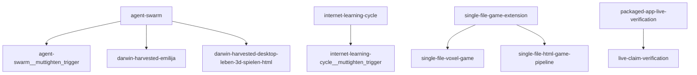

# Darwin Engine Report
_2026-11-21T00:24:10.301213+00:00 — evolutionary skill ecosystem_

**Population:** 737 Skills | **Offspring:** 2 | **Competitions:** 2

## Top 10 (fittest skills)

| Skill | Fitness | Usage | Age (days) | Mutationen W/L |
|---|---|---|---|---|
| agent-swarm | 17.77 | 4 | 37 | 0/0 |
| internet-learning-cycle | 17.0 | 1 | 0 | 0/0 |
| single-file-game-extension | 15.57 | 0 | 13 | 0/0 |
| packaged-app-live-verification | 15.57 | 0 | 13 | 0/0 |
| voxel-game-engine-extension | 15.23 | 0 | 23 | 0/0 |
| voxel-sandbox-engine | 15.23 | 0 | 23 | 0/0 |
| voxel-world-engine | 15.23 | 0 | 23 | 0/0 |
| build-artifact-verification | 15.23 | 0 | 23 | 0/0 |
| v4a-patch-safety | 15.23 | 0 | 23 | 0/0 |
| voxel-sandbox-game | 15.2 | 0 | 24 | 0/0 |

## Bottom 5 (selection candidates)

- **hf-cloud-sagemaker-iam-preflight** (Fitness 6.1, 57 days old)
- **hf-cloud-sagemaker-production-defaults** (Fitness 6.1, 57 days old)
- **hf-cloud-serving-image-selection** (Fitness 6.1, 57 days old)
- **huggingface-zerogpu** (Fitness 6.1, 57 days old)
- **cron-autotest-run-cron-entry** (Fitness 5.97, 61 days old)

## New mutations

- agent-swarm → `agent-swarm__muttighten_trigger` (op=tighten_trigger, applied=True)
- internet-learning-cycle → `internet-learning-cycle__muttighten_trigger` (op=tighten_trigger, applied=True)

## Competitions

- ⏳ `agent-swarm__muttighten_trigger` (17.77) vs `agent-swarm` (17.77)
- ⏳ `internet-learning-cycle__muttighten_trigger` (17.0) vs `internet-learning-cycle` (17.0)

## Evolution Tree

