# Darwin Engine Report
_2026-10-12T20:30:50.452824+00:00 — evolutionary skill ecosystem_

**Population:** 1119 Skills | **Offspring:** 4 | **Competitions:** 28

## Top 10 (fittest skills)

| Skill | Fitness | Usage | Age (days) | Mutationen W/L |
|---|---|---|---|---|
| autonomous-learning-architecture | 3489.0 | 2771 | 0 | 366/30 |
| auto-env-checker | 2904.4 | 2950 | 18 | 15/88 |
| asi-capability-summary | 2017.4 | 2005 | 18 | 0/0 |
| learning-loop | 1920.3 | 1909 | 51 | 0/0 |
| a2a-brain-meshlearn-verify | 1717.0 | 1704 | 0 | 0/0 |
| cdp-social-posting | 1579.0 | 1563 | 0 | 0/0 |
| darwin-cron-guard | 1102.0 | 333 | 0 | 390/24 |
| train-from-usage | 1097.3 | 1088 | 21 | 0/4 |
| darwin-harvested-training-internet-learn-log-jsonl | 1072.0 | 308 | 0 | 386/21 |
| plugin-api | 966.3 | 955 | 51 | 0/0 |

## Bottom 5 (selection candidates)

- **tao-train-optical-inspection** (Fitness 7.93, 2 days old)
- **web-artifacts-builder** (Fitness 7.93, 2 days old)
- **xlsx** (Fitness 7.93, 2 days old)
- **cron-autotest-run-cron-entry** (Fitness 7.27, 22 days old)
- **systematic-debugging** (Fitness 6.3, 51 days old)

## New mutations

- autonomous-learning-architecture → `autonomous-learning-architecture__mutbroaden_trigger` (op=broaden_trigger, applied=True)
- auto-env-checker → `auto-env-checker__mutbroaden_trigger` (op=broaden_trigger, applied=True)
- asi-capability-summary → `asi-capability-summary__muttighten_trigger` (op=tighten_trigger, applied=True)
- a2a-brain-meshlearn-verify → `a2a-brain-meshlearn-verify__mutbroaden_trigger` (op=broaden_trigger, applied=True)

## Competitions

- ⏳ `a2a-brain-meshlearn-verify+asi-capability-summary` (0) vs `None` (0)
- ⏳ `a2a-brain-meshlearn-verify__mutbroaden_trigger` (1717.0) vs `a2a-brain-meshlearn-verify` (1717.0)
- ⏳ `a2a-brain-meshlearn-verify__muttighten_trigger` (1717.0) vs `a2a-brain-meshlearn-verify` (1717.0)
- ⏳ `asi-capability-summary+asi-identity` (0) vs `None` (0)
- ⏳ `asi-capability-summary__mutbroaden_trigger` (2017.4) vs `asi-capability-summary` (2017.4)
- ⏳ `asi-capability-summary__muttighten_trigger` (2017.4) vs `asi-capability-summary` (2017.4)
- ⏳ `asi-identity+auto-env-checker` (0) vs `None` (0)
- ⏳ `auto-env-checker+autonomous-learning-architecture` (0) vs `None` (0)
- ⏳ `auto-env-checker+cdp-social-posting` (0) vs `None` (0)
- ⏳ `auto-env-checker__mutbroaden_trigger` (2904.4) vs `auto-env-checker` (2904.4)
- ⏳ `autonomous-learning-architecture__mutbroaden_trigger` (3489.0) vs `autonomous-learning-architecture` (3489.0)
- ⏳ `autonomous-learning-architecture__muttighten_trigger` (3489.0) vs `autonomous-learning-architecture` (3489.0)
- ⏳ `cdp-social-posting__mutbroaden_trigger` (1579.0) vs `cdp-social-posting` (1579.0)
- ⏳ `cdp-social-posting__muttighten_trigger` (1579.0) vs `cdp-social-posting` (1579.0)
- ⏳ `discord-server-management__mutadd_verification_step` (63.17) vs `discord-server-management` (63.17)
- ⏳ `discord-server-management__mutbroaden_trigger` (63.17) vs `discord-server-management` (63.17)
- ⏳ `discord-server-management__muttighten_trigger` (63.17) vs `discord-server-management` (63.17)
- ⏳ `github-readme-summary__mutbroaden_trigger` (40.97) vs `github-readme-summary` (40.97)
- ⏳ `github-readme-summary__muttighten_trigger` (40.97) vs `github-readme-summary` (40.97)
- ⏳ `openamer-plugin-development__muttighten_trigger` (39.97) vs `openamer-plugin-development` (39.97)
- ⏳ `plugin-api__mutbroaden_trigger` (966.3) vs `plugin-api` (966.3)
- ⏳ `plugin-api__muttighten_trigger` (966.3) vs `plugin-api` (966.3)
- ⏳ `train-from-usage__mutadd_pitfall` (1097.3) vs `train-from-usage` (1097.3)
- ⏳ `train-from-usage__mutadd_verification_step` (1097.3) vs `train-from-usage` (1097.3)
- ⏳ `train-from-usage__mutbroaden_trigger` (1097.3) vs `train-from-usage` (1097.3)
- ⏳ `train-from-usage__muttighten_trigger` (1097.3) vs `train-from-usage` (1097.3)
- ⏳ `undetectable-browsing__muttighten_trigger` (42.37) vs `undetectable-browsing` (42.37)
- ⏳ `vscode-extension-scaffold__mutbroaden_trigger` (42.3) vs `vscode-extension-scaffold` (42.3)

## Evolution Tree

```mermaid
graph TD
    asi-capability-summary["asi-capability-summary"] --> asi-capability-summary__muttighten_trigger["asi-capability-summary__muttighten_trigger"]
    a2a-brain-meshlearn-verify["a2a-brain-meshlearn-verify"] --> a2a-brain-meshlearn-verify__mutbroaden_trigger["a2a-brain-meshlearn-verify__mutbroaden_trigger"]
    autonomous-learning-architecture["autonomous-learning-architecture"] --> autonomous-learning-loops["autonomous-learning-loops"]
    darwin-cron-guard["darwin-cron-guard"] --> guard["guard"]
    darwin-harvested-training-internet-learn-log-jsonl["darwin-harvested-training-internet-learn-log-jsonl"] --> learn["learn"]
    autonomous-learning-architecture["autonomous-learning-architecture"] --> autonomous-learning-architecture__mutbroaden_trigger["autonomous-learning-architecture__mutbroaden_trigger"]
    auto-env-checker["auto-env-checker"] --> auto-env-checker__mutbroaden_trigger["auto-env-checker__mutbroaden_trigger"]
    asi-capability-summary["asi-capability-summary"] --> asi-capability-summary__muttighten_trigger["asi-capability-summary__muttighten_trigger"]
    a2a-brain-meshlearn-verify["a2a-brain-meshlearn-verify"] --> a2a-brain-meshlearn-verify__mutbroaden_trigger["a2a-brain-meshlearn-verify__mutbroaden_trigger"]
    autonomous-learning-architecture["autonomous-learning-architecture"] --> autonomous-learning-loops["autonomous-learning-loops"]
    darwin-cron-guard["darwin-cron-guard"] --> guard["guard"]
    darwin-harvested-training-internet-learn-log-jsonl["darwin-harvested-training-internet-learn-log-jsonl"] --> learn["learn"]
    autonomous-learning-architecture["autonomous-learning-architecture"] --> autonomous-learning-architecture__mutbroaden_trigger["autonomous-learning-architecture__mutbroaden_trigger"]
    auto-env-checker["auto-env-checker"] --> auto-env-checker__mutbroaden_trigger["auto-env-checker__mutbroaden_trigger"]
    asi-capability-summary["asi-capability-summary"] --> asi-capability-summary__muttighten_trigger["asi-capability-summary__muttighten_trigger"]
    a2a-brain-meshlearn-verify["a2a-brain-meshlearn-verify"] --> a2a-brain-meshlearn-verify__mutbroaden_trigger["a2a-brain-meshlearn-verify__mutbroaden_trigger"]
    autonomous-learning-architecture["autonomous-learning-architecture"] --> autonomous-learning-loops["autonomous-learning-loops"]
    darwin-cron-guard["darwin-cron-guard"] --> guard["guard"]
    darwin-harvested-training-internet-learn-log-jsonl["darwin-harvested-training-internet-learn-log-jsonl"] --> learn["learn"]
    autonomous-learning-architecture["autonomous-learning-architecture"] --> autonomous-learning-architecture__mutbroaden_trigger["autonomous-learning-architecture__mutbroaden_trigger"]
    auto-env-checker["auto-env-checker"] --> auto-env-checker__mutbroaden_trigger["auto-env-checker__mutbroaden_trigger"]
    asi-capability-summary["asi-capability-summary"] --> asi-capability-summary__muttighten_trigger["asi-capability-summary__muttighten_trigger"]
    a2a-brain-meshlearn-verify["a2a-brain-meshlearn-verify"] --> a2a-brain-meshlearn-verify__mutbroaden_trigger["a2a-brain-meshlearn-verify__mutbroaden_trigger"]
    autonomous-learning-architecture["autonomous-learning-architecture"] --> autonomous-learning-loops["autonomous-learning-loops"]
    darwin-cron-guard["darwin-cron-guard"] --> guard["guard"]
    darwin-harvested-training-internet-learn-log-jsonl["darwin-harvested-training-internet-learn-log-jsonl"] --> learn["learn"]
    autonomous-learning-architecture["autonomous-learning-architecture"] --> autonomous-learning-architecture__mutbroaden_trigger["autonomous-learning-architecture__mutbroaden_trigger"]
    auto-env-checker["auto-env-checker"] --> auto-env-checker__mutbroaden_trigger["auto-env-checker__mutbroaden_trigger"]
    asi-capability-summary["asi-capability-summary"] --> asi-capability-summary__muttighten_trigger["asi-capability-summary__muttighten_trigger"]
    a2a-brain-meshlearn-verify["a2a-brain-meshlearn-verify"] --> a2a-brain-meshlearn-verify__mutbroaden_trigger["a2a-brain-meshlearn-verify__mutbroaden_trigger"]
    autonomous-learning-architecture["autonomous-learning-architecture"] --> autonomous-learning-loops["autonomous-learning-loops"]
    darwin-cron-guard["darwin-cron-guard"] --> guard["guard"]
    darwin-harvested-training-internet-learn-log-jsonl["darwin-harvested-training-internet-learn-log-jsonl"] --> learn["learn"]
    autonomous-learning-architecture["autonomous-learning-architecture"] --> autonomous-learning-architecture__mutbroaden_trigger["autonomous-learning-architecture__mutbroaden_trigger"]
    auto-env-checker["auto-env-checker"] --> auto-env-checker__mutbroaden_trigger["auto-env-checker__mutbroaden_trigger"]
    asi-capability-summary["asi-capability-summary"] --> asi-capability-summary__muttighten_trigger["asi-capability-summary__muttighten_trigger"]
    a2a-brain-meshlearn-verify["a2a-brain-meshlearn-verify"] --> a2a-brain-meshlearn-verify__mutbroaden_trigger["a2a-brain-meshlearn-verify__mutbroaden_trigger"]
    autonomous-learning-architecture["autonomous-learning-architecture"] --> autonomous-learning-loops["autonomous-learning-loops"]
    darwin-cron-guard["darwin-cron-guard"] --> guard["guard"]
    darwin-harvested-training-internet-learn-log-jsonl["darwin-harvested-training-internet-learn-log-jsonl"] --> learn["learn"]
```

