# Darwin Engine Report
_2026-11-24T20:15:34.866744+00:00 — evolutionary skill ecosystem_

**Population:** 1331 Skills | **Offspring:** 4 | **Competitions:** 34

## Top 10 (fittest skills)

| Skill | Fitness | Usage | Age (days) | Mutationen W/L |
|---|---|---|---|---|
| darwin-cron-guard | 3777.0 | 9 | 0 | 1940/126 |
| darwin-harvested-training-internet-learn-log-jsonl | 3751.0 | 2 | 0 | 1878/21 |
| autonomous-learning-architecture | 3456.0 | 28 | 0 | 1859/306 |
| review | 959.5 | 948 | 45 | 0/0 |
| mini-openamer | 223.63 | 212 | 41 | 0/0 |
| learning-loop | 134.87 | 125 | 94 | 0/0 |
| longterm-memory | 74.0 | 61 | 0 | 0/0 |
| darwin-harvested-openamer-cli-main-py | 67.57 | 0 | 43 | 40/24 |
| darwin-harvested-n-permission-8-permission-denied-n-f | 66.57 | 0 | 43 | 40/25 |
| darwin-harvested-tmp-deepseek-harness-agents-skills | 62.57 | 0 | 43 | 38/25 |

## Bottom 5 (selection candidates)

- **tao-train-optical-inspection** (Fitness 6.5, 45 days old)
- **web-artifacts-builder** (Fitness 6.5, 45 days old)
- **xlsx** (Fitness 6.5, 45 days old)
- **cron-autotest-run-cron-entry** (Fitness 5.83, 65 days old)
- **self-rewriter** (Fitness -6.87, 86 days old)

## New mutations

- darwin-cron-guard → `darwin-cron-guard__mutbroaden_trigger` (op=broaden_trigger, applied=True)
- darwin-harvested-training-internet-learn-log-jsonl → `darwin-harvested-training-internet-learn-log-jsonl__mutbroaden_trigger` (op=broaden_trigger, applied=True)
- autonomous-learning-architecture → `autonomous-learning-architecture__muttighten_trigger` (op=tighten_trigger, applied=True)
- mini-openamer → `mini-openamer__mutbroaden_trigger` (op=broaden_trigger, applied=True)

## Competitions

- ⏳ `a2a-brain-meshlearn-verify+asi-capability-summary` (0) vs `None` (0)
- ⏳ `a2a-brain-meshlearn-verify__mutbroaden_trigger` (32.57) vs `a2a-brain-meshlearn-verify` (32.57)
- ⏳ `a2a-brain-meshlearn-verify__muttighten_trigger` (32.57) vs `a2a-brain-meshlearn-verify` (32.57)
- ⏳ `asi-capability-summary+asi-identity` (0) vs `None` (0)
- ⏳ `asi-capability-summary__mutbroaden_trigger` (36.97) vs `asi-capability-summary` (36.97)
- ⏳ `asi-capability-summary__muttighten_trigger` (36.97) vs `asi-capability-summary` (36.97)
- ⏳ `asi-identity+auto-env-checker` (0) vs `None` (0)
- ⏳ `auto-env-checker+autonomous-learning-architecture` (0) vs `None` (0)
- ⏳ `auto-env-checker+cdp-social-posting` (0) vs `None` (0)
- ⏳ `auto-env-checker__mutbroaden_trigger` (18.97) vs `auto-env-checker` (18.97)
- ⏳ `auto-env-checker__muttighten_trigger` (18.97) vs `auto-env-checker` (18.97)
- ⏳ `autonomous-learning-architecture__mutbroaden_trigger` (3456.0) vs `autonomous-learning-architecture` (3456.0)
- ⏳ `autonomous-learning-architecture__muttighten_trigger` (3456.0) vs `autonomous-learning-architecture` (3456.0)
- ⏳ `cdp-social-posting__mutbroaden_trigger` (22.6) vs `cdp-social-posting` (22.6)
- ⏳ `cdp-social-posting__muttighten_trigger` (22.6) vs `cdp-social-posting` (22.6)
- ⏳ `darwin-cron-guard__mutbroaden_trigger` (3777.0) vs `darwin-cron-guard` (3777.0)
- ⏳ `darwin-cron-guard__muttighten_trigger` (3777.0) vs `darwin-cron-guard` (3777.0)
- ⏳ `darwin-harvested-training-internet-learn-log-jsonl__mutbroaden_trigger` (3751.0) vs `darwin-harvested-training-internet-learn-log-jsonl` (3751.0)
- ⏳ `darwin-harvested-training-internet-learn-log-jsonl__muttighten_trigger` (3751.0) vs `darwin-harvested-training-internet-learn-log-jsonl` (3751.0)
- ⏳ `discord-server-management__mutadd_verification_step` (11.73) vs `discord-server-management` (11.73)
- ⏳ `discord-server-management__mutbroaden_trigger` (11.73) vs `discord-server-management` (11.73)
- ⏳ `discord-server-management__muttighten_trigger` (11.73) vs `discord-server-management` (11.73)
- ⏳ `github-readme-summary__mutbroaden_trigger` (18.53) vs `github-readme-summary` (18.53)
- ⏳ `github-readme-summary__muttighten_trigger` (18.53) vs `github-readme-summary` (18.53)
- ⏳ `mini-openamer__mutbroaden_trigger` (223.63) vs `mini-openamer` (223.63)
- ⏳ `openamer-plugin-development__muttighten_trigger` (20.93) vs `openamer-plugin-development` (20.93)
- ⏳ `plugin-api__mutbroaden_trigger` (0) vs `plugin-api` (0)
- ⏳ `plugin-api__muttighten_trigger` (0) vs `plugin-api` (0)
- ⏳ `train-from-usage__mutadd_pitfall` (27.87) vs `train-from-usage` (27.87)
- ⏳ `train-from-usage__mutadd_verification_step` (27.87) vs `train-from-usage` (27.87)
- ⏳ `train-from-usage__mutbroaden_trigger` (27.87) vs `train-from-usage` (27.87)
- ⏳ `train-from-usage__muttighten_trigger` (27.87) vs `train-from-usage` (27.87)
- ⏳ `undetectable-browsing__muttighten_trigger` (17.93) vs `undetectable-browsing` (17.93)
- ⏳ `vscode-extension-scaffold__mutbroaden_trigger` (15.87) vs `vscode-extension-scaffold` (15.87)

## Evolution Tree

```mermaid
graph TD
    mini-openamer["mini-openamer"] --> mini-openamer__mutbroaden_trigger["mini-openamer__mutbroaden_trigger"]
    darwin-cron-guard["darwin-cron-guard"] --> darwin-cron-guard__mutbroaden_trigger["darwin-cron-guard__mutbroaden_trigger"]
    darwin-harvested-training-internet-learn-log-jsonl["darwin-harvested-training-internet-learn-log-jsonl"] --> darwin-harvested-training-internet-learn-log-jsonl__mutbroaden_trigger["darwin-harvested-training-internet-learn-log-jsonl__mutbroaden_trigger"]
    autonomous-learning-architecture["autonomous-learning-architecture"] --> autonomous-learning-architecture__muttighten_trigger["autonomous-learning-architecture__muttighten_trigger"]
    mini-openamer["mini-openamer"] --> mini-openamer__mutbroaden_trigger["mini-openamer__mutbroaden_trigger"]
    darwin-cron-guard["darwin-cron-guard"] --> darwin-harvested-demo-cli-no-such-file-or-directory-n["darwin-harvested-demo-cli-no-such-file-or-directory-n"]
    darwin-cron-guard["darwin-cron-guard"] --> darwin-harvested-t-c71f59a6-nfatal-cannot-change-to["darwin-harvested-t-c71f59a6-nfatal-cannot-change-to"]
    darwin-cron-guard["darwin-cron-guard"] --> guard["guard"]
    darwin-harvested-training-internet-learn-log-jsonl["darwin-harvested-training-internet-learn-log-jsonl"] --> learn["learn"]
    autonomous-learning-architecture["autonomous-learning-architecture"] --> autonomous-learning-loops["autonomous-learning-loops"]
    darwin-cron-guard["darwin-cron-guard"] --> darwin-cron-guard__mutbroaden_trigger["darwin-cron-guard__mutbroaden_trigger"]
    darwin-harvested-training-internet-learn-log-jsonl["darwin-harvested-training-internet-learn-log-jsonl"] --> darwin-harvested-training-internet-learn-log-jsonl__mutbroaden_trigger["darwin-harvested-training-internet-learn-log-jsonl__mutbroaden_trigger"]
    autonomous-learning-architecture["autonomous-learning-architecture"] --> autonomous-learning-architecture__muttighten_trigger["autonomous-learning-architecture__muttighten_trigger"]
    mini-openamer["mini-openamer"] --> mini-openamer__mutbroaden_trigger["mini-openamer__mutbroaden_trigger"]
    darwin-cron-guard["darwin-cron-guard"] --> guard["guard"]
    darwin-harvested-training-internet-learn-log-jsonl["darwin-harvested-training-internet-learn-log-jsonl"] --> learn["learn"]
    autonomous-learning-architecture["autonomous-learning-architecture"] --> autonomous-learning-loops["autonomous-learning-loops"]
    darwin-cron-guard["darwin-cron-guard"] --> darwin-cron-guard__mutbroaden_trigger["darwin-cron-guard__mutbroaden_trigger"]
    darwin-harvested-training-internet-learn-log-jsonl["darwin-harvested-training-internet-learn-log-jsonl"] --> darwin-harvested-training-internet-learn-log-jsonl__mutbroaden_trigger["darwin-harvested-training-internet-learn-log-jsonl__mutbroaden_trigger"]
    autonomous-learning-architecture["autonomous-learning-architecture"] --> autonomous-learning-architecture__muttighten_trigger["autonomous-learning-architecture__muttighten_trigger"]
    mini-openamer["mini-openamer"] --> mini-openamer__mutbroaden_trigger["mini-openamer__mutbroaden_trigger"]
    darwin-cron-guard["darwin-cron-guard"] --> darwin-harvested-scripts-cron-i18n-converge-py["darwin-harvested-scripts-cron-i18n-converge-py"]
    darwin-cron-guard["darwin-cron-guard"] --> darwin-harvested-npu-server-bg-log["darwin-harvested-npu-server-bg-log"]
    darwin-cron-guard["darwin-cron-guard"] --> guard["guard"]
    darwin-harvested-training-internet-learn-log-jsonl["darwin-harvested-training-internet-learn-log-jsonl"] --> learn["learn"]
    autonomous-learning-architecture["autonomous-learning-architecture"] --> autonomous-learning-loops["autonomous-learning-loops"]
    darwin-cron-guard["darwin-cron-guard"] --> darwin-cron-guard__mutbroaden_trigger["darwin-cron-guard__mutbroaden_trigger"]
    darwin-harvested-training-internet-learn-log-jsonl["darwin-harvested-training-internet-learn-log-jsonl"] --> darwin-harvested-training-internet-learn-log-jsonl__mutbroaden_trigger["darwin-harvested-training-internet-learn-log-jsonl__mutbroaden_trigger"]
    autonomous-learning-architecture["autonomous-learning-architecture"] --> autonomous-learning-architecture__muttighten_trigger["autonomous-learning-architecture__muttighten_trigger"]
    mini-openamer["mini-openamer"] --> mini-openamer__mutbroaden_trigger["mini-openamer__mutbroaden_trigger"]
    darwin-cron-guard["darwin-cron-guard"] --> guard["guard"]
    darwin-harvested-training-internet-learn-log-jsonl["darwin-harvested-training-internet-learn-log-jsonl"] --> learn["learn"]
    autonomous-learning-architecture["autonomous-learning-architecture"] --> autonomous-learning-loops["autonomous-learning-loops"]
    darwin-cron-guard["darwin-cron-guard"] --> darwin-cron-guard__mutbroaden_trigger["darwin-cron-guard__mutbroaden_trigger"]
    darwin-harvested-training-internet-learn-log-jsonl["darwin-harvested-training-internet-learn-log-jsonl"] --> darwin-harvested-training-internet-learn-log-jsonl__mutbroaden_trigger["darwin-harvested-training-internet-learn-log-jsonl__mutbroaden_trigger"]
    autonomous-learning-architecture["autonomous-learning-architecture"] --> autonomous-learning-architecture__muttighten_trigger["autonomous-learning-architecture__muttighten_trigger"]
    mini-openamer["mini-openamer"] --> mini-openamer__mutbroaden_trigger["mini-openamer__mutbroaden_trigger"]
    darwin-cron-guard["darwin-cron-guard"] --> guard["guard"]
    darwin-harvested-training-internet-learn-log-jsonl["darwin-harvested-training-internet-learn-log-jsonl"] --> learn["learn"]
    autonomous-learning-architecture["autonomous-learning-architecture"] --> autonomous-learning-loops["autonomous-learning-loops"]
```

